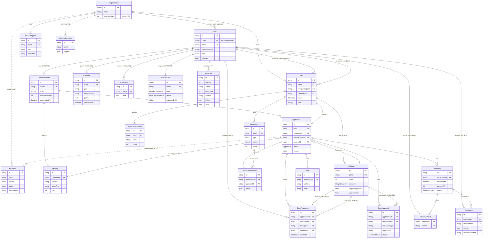

# Database

PostgreSQL via Prisma (`prisma/schema.prisma`). IDs are `cuid()` strings. 23 models, 8 enums.

## ER diagram

Relations without a foreign key in the schema (plain string columns) are shown with dotted lines.



## Enums

`Role` (EMPLOYER, RECRUITER, HIRING_MANAGER, CANDIDATE) / `JobStatus` (DRAFT, PUBLISHED, PAUSED, CLOSED) / `StageCategory` (ACTIVE, HIRED, REJECTED) / `AppStatus` (ACTIVE, HIRED, REJECTED, WITHDRAWN) / `ApprovalStatus` (PENDING, APPROVED, REJECTED) / `InterviewStatus` (SCHEDULED, COMPLETED, CANCELLED) / `DataRequestType` (EXPORT, DELETE) / `DataRequestStatus` (PENDING, APPROVED, REJECTED, COMPLETED).
Some values are plain `String` columns validated only in the API layer: `Job.employmentType`, `JobQuestion.type`, `Application.source`, `Interview.mode`, `Scorecard.recommendation`, `Consent.type`, `EmailLog.status`.

## Tables and key columns

| Table | Key columns / purpose |
|---|---|
| Organization | `name`, `retentionDays` (default 180; USP H retention period). Tenant root. |
| User | `email` (globally unique), `passwordHash` (bcrypt), `role`, `orgId` (null for candidates), `isActive` (soft-disable, also set on anonymization). |
| CandidateProfile | 1:1 with a candidate User. `phone, location, linkedin, headline, skills[], experienceYears`, `anonymizedAt` (set when PII was erased). |
| Resume | `fileKey` (object-storage key, never exposed; downloads use signed URLs), `fileName, mimeType, size`. |
| Consent | Append-only consent ledger: `type` (`DATA_PROCESSING`, `TALENT_POOL`, `MARKETING`, `APPLICATION:<jobId>`), `policyVersion`, `granted`, `ip`, `withdrawnAt`. |
| Job | Vacancy: salary band, `skills[]`, `status`, `hiringManagerId` (nullable), `createdById`, `publishedAt`, `closedAt`. |
| JobQuestion | Per-job screening question: `type`, `options[]`, `required`, `order`. |
| JobStage | USP G: a vacancy's own ordered stages: `order`, `category`, `notifyCandidate`, `emailTemplateKey`, `requiresApproval`, `approverRole`. |
| PipelineTemplate | Reusable stage list stored as `stages` JSON (copied into JobStage rows when a job is created from it). |
| ScorecardCriterion | Criteria names for a job; scorecard `ratings` keys must match exactly. |
| Application | A candidate's application: `currentStageId`, `status`, `source`, `rejectionReason`, `resumeId`, `appliedAt`, `updatedAt` (used for optimistic locking and retention). |
| ApplicationAnswer | `value` JSON (string / string[] / boolean). |
| Note | Internal recruiter notes; `authorId` is a plain string (no FK). |
| StageTransition | Immutable move log: `fromStageId` (null for the initial "Applied" row), `toStageId`, `movedById`, `note`, `createdAt`. Source of truth for analytics. |
| StageApproval | USP G: pending/decided approval to enter a gated stage: `targetStageId`, `requestedById`, `approverId`, `status`, `comment`, `decidedAt`. |
| Interview | `scheduledAt`, `durationMin`, `mode`, `locationOrLink`, `status`. |
| InterviewPanel | Join table, composite PK `(interviewId, userId)`. |
| Scorecard | `ratings` JSON `{criterion: 1..5}`, `comments`, `recommendation`, `submittedAt`. |
| EmailTemplate | Handlebars `subject` / `bodyHtml` per org and `key`. |
| EmailLog | Every templated email: `toEmail`, `templateKey`, `status` QUEUED/SENT/FAILED, `error`, `applicationId`. |
| Notification | In-app candidate messages (`read`). |
| AuditLog | Append-only trail: `actorId, actorRole, action, entityType, entityId, before/after` JSON, `ip`. |
| DataRequest | USP H: `type` EXPORT/DELETE, `status`, `reason`, `reviewedById`, `completedAt`. |

## Constraints

- `User.email` unique; `CandidateProfile.userId` unique.
- **`Application (jobId, candidateId)` unique**: one application per candidate per job (API returns 409 earlier, DB is the safety net).
- **`Scorecard (interviewId, interviewerId)` unique**: one scorecard per interviewer per interview (the API upserts).
- **`EmailTemplate (orgId, key)` unique**: one template per key per organization (upsert target of `PUT /admin/email-templates/{key}`). Note: the uniqueness named "templates" applies to email templates; `PipelineTemplate` has no unique constraint.
- `InterviewPanel` PK `(interviewId, userId)`.

### Delete behavior

| Parent -> child | On delete |
|---|---|
| User -> CandidateProfile, Consent, Notification, DataRequest, InterviewPanel, Scorecard | CASCADE |
| CandidateProfile -> Resume, Application | CASCADE |
| Job -> JobQuestion, JobStage, ScorecardCriterion, Application | CASCADE |
| Application -> ApplicationAnswer, Note, StageTransition, StageApproval, Interview | CASCADE |
| JobQuestion -> ApplicationAnswer | CASCADE |
| JobStage -> StageTransition (toStage), StageApproval (targetStage) | CASCADE |
| JobStage -> StageTransition (fromStage) | **SET NULL** |
| Interview -> InterviewPanel, Scorecard | CASCADE |
| Resume -> Application.resumeId | **SET NULL** |
| User -> StageTransition.movedById | **SET NULL** |
| Application.currentStageId -> JobStage, Job -> Organization / hiringManager / createdBy, User -> Organization | default RESTRICT (a stage with applications cannot be deleted; the API pre-checks and returns 409) |

Columns without foreign keys: `Note.authorId`, `StageApproval.requestedById/approverId`, `DataRequest.reviewedById`, `AuditLog.actorId`, `EmailLog.orgId/applicationId`, `PipelineTemplate.orgId`. This deliberately keeps audit/history rows intact when users are removed, but means the DB does not enforce those references.

## Indexes

| Index | Why |
|---|---|
| `Job (orgId, status)` | Job lists per org and the vacancies report (`groupBy status`) |
| `Application (jobId, currentStageId)` | **Kanban query**: all cards of a job grouped by stage; also stage card counts |
| `Application (status)` | Overview/analytics counts, retention scan |
| `Application (jobId, candidateId)` unique | Duplicate-apply check, candidate "my applications" lookups |
| `StageTransition (applicationId, createdAt)` | Application timeline, funnel/time-to-stage joins |
| `StageTransition (toStageId)` | Funnel and time-to-stage aggregations per stage |
| `StageApproval (status)` | Approvals inbox (`status=PENDING`) |
| `JobStage (jobId, order)` | Ordered pipeline load |
| `Interview (scheduledAt)` | Double-booking window search (+-1 day), "upcoming interviews" |
| `InterviewPanel (userId)` | "My interviews" and clash detection by interviewer |
| `JobQuestion (jobId)`, `Resume (candidateId)`, `Consent (userId)`, `EmailLog (applicationId)`, `Notification (userId, read)` | Foreign-key lookups / unread counts |
| `AuditLog (entityType, entityId)` | Entity history ("who changed this job/application") |
| `AuditLog (createdAt)` | Newest-first paging of the audit log |

Not indexed yet: `ScorecardCriterion.jobId`, `ApplicationAnswer.applicationId`, `Note.applicationId`, `Interview.applicationId`, `StageApproval.applicationId`, `AuditLog.actorId`.

## USP G: per-vacancy pipeline and approval gates

- Each `Job` owns its stages as `JobStage` rows (not a global enum). Stages carry `order`, `category` (ACTIVE / HIRED / REJECTED), candidate-notification settings and an approval rule (`requiresApproval` + `approverRole`).
- Jobs are created from explicit `stages`, a `PipelineTemplate` (JSON copied into JobStage rows) or the default 7-stage pipeline. Stage lists are validated (>= 2 stages, first ACTIVE, a REJECTED stage exists, unique names, approver role when approval required) and editable later via `PUT /jobs/{id}/stages`; a stage that still holds applications cannot be removed.
- `Application.currentStageId` points at the current JobStage; `Application.status` is derived from the stage category (HIRED/REJECTED/ACTIVE), WITHDRAWN is set by the candidate.
- Moving into a gated stage by a non-approver creates a `StageApproval` (PENDING) instead of moving, and the API answers 202. An approver (the configured role, or EMPLOYER at any time) either moves directly (a self-approved APPROVED row is recorded for traceability) or decides the pending row, which then performs the move. Moves use an optimistic lock (`updateMany` on `currentStageId` + `status`) plus a `StageTransition` row in the same transaction.

## USP H: governance and data protection

| Concern | Modelling |
|---|---|
| Consent | `Consent` rows per user (type, policyVersion, ip, `granted`, `withdrawnAt`). Registration writes `DATA_PROCESSING` (+ optional `TALENT_POOL`); each application writes `APPLICATION:<jobId>`. Withdrawal sets `withdrawnAt` on open rows. Seed policy version `2026-11`. |
| Access / deletion rights | `DataRequest` (type EXPORT/DELETE, status PENDING -> COMPLETED/REJECTED, `reviewedById`). Export is generated on demand by `GET /me/export`; deletion needs an EMPLOYER decision. |
| Right to erasure | `anonymizeCandidate`: user name/email replaced by `deleted-<id>@anonymized.local`, password randomized, `isActive=false`; profile PII nulled, `skills=[]`, `anonymizedAt` set; resume rows and S3 objects, answers, notes, notifications deleted; `EmailLog.toEmail` rewritten. Applications and `StageTransition` rows are kept, so analytics survive. |
| Retention | `Organization.retentionDays` (30..3650). `runRetention` anonymizes candidates whose every application in the org is REJECTED/WITHDRAWN and last updated before `now - retentionDays` (triggered by `POST /admin/retention/run`). |
| Audit | `AuditLog` is written by every mutating route (and resume views, exports, retention runs) with before/after JSON, actor, role and IP. Append-only by convention (no update/delete route). |
| Least privilege | Interviewers see masked email/phone; resume URLs are signed and every staff view is audited. |

## Analytics from StageTransition

`StageTransition` is written for every stage change, including the first row at application time (`fromStageId` NULL, `movedById` = candidate). Reports (`src/routes/reports.ts`) are single SQL aggregations:

- **Funnel**: `COUNT(DISTINCT application)` that have a transition into each non-REJECTED stage / total applications in scope (percent).
- **Time-to-stage**: `AVG(transition.createdAt - application.appliedAt)` in days per target stage, excluding the initial row (`fromStageId IS NOT NULL`).
- **Overview / sources**: counts from `Application.status` and `source`; upcoming interviews from `Interview`.
- **Vacancies**: `Job` grouped by `status`.

Because stage history is rows, not a column, analytics still work after candidates are anonymized and after pipelines are edited (deleted source stages leave `fromStageId` NULL).

## Migrations

Located in `prisma/migrations/` (`20261108080917_init`, `20261108081450_email_log_org`).

```bash
npx prisma migrate deploy   # apply pending migrations (production / CI) - npm run db:deploy
npx prisma migrate dev      # create + apply a new migration in development - npm run db:migrate
```

`DATABASE_URL` must be set (`.env`).

## Seed (`npm run db:seed`)

Runs `prisma/seed.ts`. It **first deletes all data** in every table, then creates:

- 1 organization: Acme Technologies (`retentionDays` 180).
- 5 staff users: `employer@acme.test` (EMPLOYER), `recruiter@acme.test` and `recruiter2@acme.test` (RECRUITER), `manager@acme.test` and `manager2@acme.test` (HIRING_MANAGER). All passwords are the demo value `Password123!`.
- 26 candidate users with profiles, skills and a generated PDF resume uploaded to object storage; `candidate@acme.test` is the first one. Each has a `DATA_PROCESSING` consent.
- 6 email templates (application_received, stage_changed, interview_scheduled, offer, hired, rejected) and 2 pipeline templates ("Internship (lean)", "Standard hiring").
- 5 jobs in different states: Senior Full Stack Engineer (PUBLISHED), Frontend Developer Intern (PUBLISHED, lean pipeline with an EMPLOYER-approved Offer), Product Designer (PAUSED), Data Analyst (CLOSED), DevOps Engineer (DRAFT). Each has 3 questions, 4 default scorecard criteria and its own stages.
- 36 applications spread across stages (several hired/rejected) with back-dated `StageTransition` history, answers and varied sources (LinkedIn, referral, job board, website).
- Technical interviews for everyone who reached an interview-like stage (completed ones for finished candidates, upcoming SCHEDULED ones otherwise), each with a 2-person panel, and 2 scorecards (one per panelist) on each completed interview.
- 1 pending `StageApproval` (an application waiting at the Offer gate of the first job, requested by the recruiter).
- 1 pending DELETE `DataRequest` (the last candidate).
- Initial `AuditLog` rows (organization seed + job creation).
