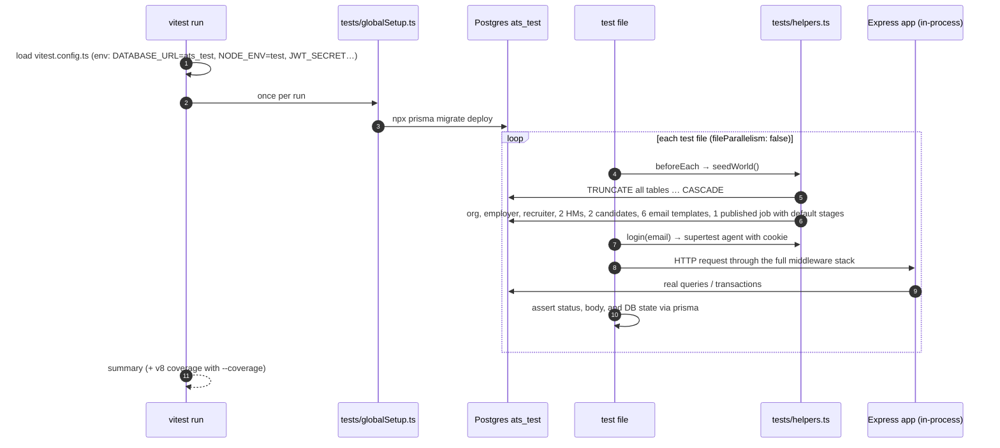
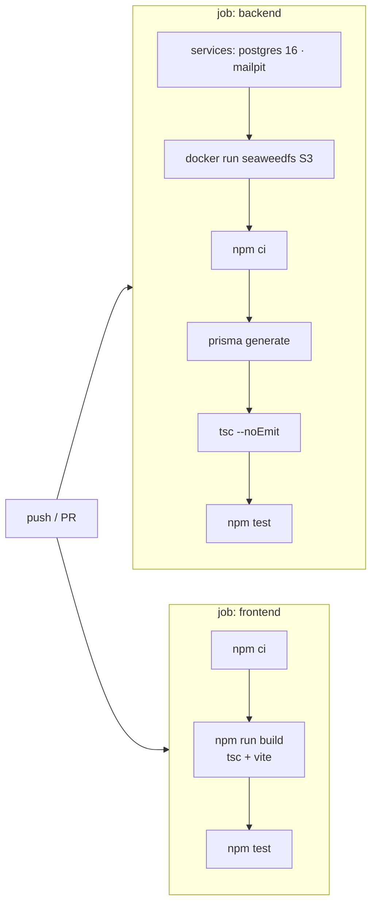

# Test Workflow

How HireFlow is tested: what runs, against what, in which order, and what each suite proves.

**Current result:** backend **67/67 passing** (6 files), frontend **7/7 passing** (3 files). Backend line coverage is **74%** (statements 71%, branches 59%, functions 64%).

---

## 1. Test pyramid

```mermaid
flowchart TB
  subgraph E2E["Manual / demo (browser)"]
    M[Recruiter, candidate and employer journeys<br/>checked in the browser + Mailpit]
  end
  subgraph INT["Backend integration: 42 tests"]
    I[Supertest → real Express app → real Postgres, S3, SMTP<br/>auth · RBAC · validation · pipeline · interviews · governance]
  end
  subgraph UNIT["Unit: 25 backend + 7 frontend"]
    U[pure functions: access rules, stage validation, approvals,<br/>overlap, template escaping · api() wrapper, guards, status helper]
  end
  E2E --- INT --- UNIT
```

The integration tests use **real infrastructure** (Postgres, SeaweedFS S3 and Mailpit in Docker) rather than mocks, so they catch SQL, constraint, transaction and upload bugs that mocks would hide.

---

## 2. How a backend test run works



Key design decisions:

| Decision | Why |
|---|---|
| Separate database `ats_test` | Tests never touch the seeded demo data in `ats`. |
| `TRUNCATE … CASCADE` before each test | Every test starts from a known world, so order doesn't matter. |
| `fileParallelism: false` | Files share one database, so running them in sequence avoids cross-talk. |
| `request.agent(app)` | Cookies persist across calls, exactly like a browser session. |
| Assert on the DB as well as the response | e.g. after a move, check that the `StageTransition` and `AuditLog` rows exist. |
| Login rate limit raised when `NODE_ENV=test` | Many logins per run would otherwise trip the 20 / 15 min limit. |

---

## 3. Running the tests

### Prerequisites (once)

```bash
docker compose up -d db storage mailpit
```

```bash
docker exec proeducateintern-db-1 createdb -U ats ats_test
```

### Backend

```bash
cd backend && npm test
```

```bash
cd backend && npm run test:coverage
```

Coverage writes a text summary to the console and an HTML report to `backend/coverage/`.

### Frontend

```bash
cd frontend && npm test
```

Frontend tests run in jsdom with `@testing-library/react`. `fetch` is stubbed, so no backend is needed.

### Type checks (also run in CI)

```bash
cd backend && npx tsc --noEmit
```

```bash
cd frontend && npx tsc --noEmit
```

---

## 4. Continuous integration

`.github/workflows/ci.yml` runs on every push and pull request:



The CI Postgres service creates `ats_test` directly, and `globalSetup` migrates it. That is the same path as a local run.

---

## 5. What each suite proves

### `backend/tests/unit.test.ts`: 25 tests, pure business rules

| Area | Cases |
|---|---|
| `canTransitionJob` | legal moves allowed; illegal ones (e.g. CLOSED → PUBLISHED) rejected |
| `canSeeJob` / `canSeeApplication` | candidates never get the staff view; other orgs blocked; employer and recruiter allowed; HM only own jobs; candidate only own application |
| `maskPII` | email → `a***@x.com`, phone → `********12`; nulls kept |
| `validateStages` | default pipeline valid; needs a Rejected stage; names unique (case-insensitive); approval needs an approver role; ≥ 2 stages and an active first stage |
| `canApprove` | employer always; owning HM yes; other HM no; recruiter no for an HM gate; matching non-HM role yes |
| `overlaps` | overlap, containment, back-to-back is **not** a clash, disjoint |
| `render` | substitutes variables; **HTML-escapes** them (no injection via candidate names) |

### `backend/tests/auth_rbac.test.ts`: 11 tests

| Test | Expected |
|---|---|
| register with consent | 201 + session cookie works on `/auth/me` |
| register without consent | 400 |
| duplicate email | 409 |
| good / bad password | 200 / 401 |
| `/auth/me` without cookie | 401 |
| deactivated user logs in | 401 |
| logout | cookie cleared → 401 afterwards |
| candidate on `/reports/overview`, `GET /jobs`, `POST /jobs` | 403 each |
| HM opens another HM's job applications | 403 |
| candidate withdraws someone else's application | 403 |
| recruiter creates a user / employer creates a user | 403 / 201 |

### `backend/tests/jobs_validation.test.ts`: 8 tests

| Test | Expected |
|---|---|
| `salaryMin > salaryMax` | 400 |
| valid job | 201 with default stages and scorecard criteria |
| required question unanswered | 400, `details.missing` lists the question |
| `PATCH /me/profile` with `email` | 400 (strict schema, so candidates can't change protected fields) |
| DRAFT → PUBLISHED, then CLOSED → PUBLISHED | 200, then 409 |
| apply to PAUSED job | 400 |
| apply twice | 409 (unique jobId + candidateId) |
| public board | only PUBLISHED jobs listed |

### `backend/tests/pipeline.test.ts`: 10 tests (USP G)

| Test | Expected |
|---|---|
| move to Screening | 200; `StageTransition` row; `AuditLog` action `MOVE_STAGE` |
| move to another job's stage | 400 |
| recruiter → Offer (approval gate) | **202**, application stays put; HM approves → moves to Offer; recruiter deciding → 403 |
| a different HM decides | 403 |
| approval denied | application remains in the original stage |
| reject, then move again | status `REJECTED`; later move → 409 |
| `PUT /jobs/:id/stages` rename + reorder + add | 200, new order persisted |
| delete a stage holding candidates | 409 |
| delete an empty stage | 200 |
| stage list without Rejected | 400 |

### `backend/tests/interviews.test.ts`: 7 tests

| Test | Expected |
|---|---|
| schedule | 201 with panel |
| date in the past | 400 |
| same interviewer, overlapping slot | **409 double booking** |
| scorecard from a non-panel user | 403 |
| scorecard missing a criterion | 400 |
| valid scorecard | 201 and stored |
| `GET /interviews/mine` | candidate email and phone come back masked |

### `backend/tests/governance.test.ts`: 6 tests (USP H)

| Test | Expected |
|---|---|
| `GET /me/export` | JSON contains the candidate's applications |
| deletion request → employer approves | email becomes `deleted-…@anonymized.local`, phone null, **application row still exists** |
| deletion request rejected | data unchanged |
| retention run | recruiter can't trigger it (403); employer run anonymizes the 90-day-old rejected candidate, leaves the active candidate untouched, and keeps the application row (age is set via raw SQL because `updatedAt` is auto-managed) |
| audit log | staff can read it; candidate gets 403 |
| resume upload | PDF → 201 (stored in S3), `.txt` → 400, no file → 400 |

### Frontend: 7 tests

| File | Cases |
|---|---|
| `api.test.ts` | sends JSON with credentials and returns data and status (so 202 can be told apart from 200); throws `ApiError` with status, error and details; handles empty 204 and non-JSON error bodies |
| `RequireRole.test.tsx` | anonymous → `/login`; candidate on a staff page → `/portal`; allowed role sees the page |
| `jobStatus.test.ts` | the UI offers only the status transitions the API accepts |

---

## 6. Requirement → test traceability

| Requirement from the brief | Covered by |
|---|---|
| Secure authentication | auth_rbac: register/login/logout/inactive/401 |
| Role-based access (4 roles) | auth_rbac RBAC block, unit `canSeeJob`/`canApprove`, frontend `RequireRole` |
| Job posting + application forms | jobs_validation: create, required answers, status machine, public board |
| Resume upload | governance: PDF/TXT/missing |
| Recruitment pipeline | pipeline: move, cross-job guard, reject, terminal state |
| **Configurable workflow + approvals (USP G)** | pipeline: approval gate, deny, stage CRUD rules; unit `validateStages` |
| Interview scheduling + structured evaluation | interviews: schedule, past date, double booking, scorecard rules |
| Communication templates | unit `render` (escaping); integration flows send real mail to Mailpit |
| **Data governance (USP H)** | governance: export, deletion approve/reject, retention; interviews: PII masking |
| Audit history | pipeline `MOVE_STAGE` row; governance audit access |
| Validation | jobs_validation salary/required/strict profile; zod 400s throughout |

---

## 7. Edge cases worth showing in the demo

These are all covered by tests above and are visible in the UI:

1. **Approval gate:** a recruiter drags a card to *Offer*. The API returns 202, the card shows "Approval pending", the hiring manager approves under Approvals, and the card moves.
2. **Double booking:** schedule a second interview for the same interviewer at an overlapping time. The 409 message names the busy interviewer.
3. **IDOR:** log in as a candidate and request another candidate's application or a staff endpoint. Both return 403.
4. **Workflow safety:** in the workflow editor, delete a stage that still has candidates. The 409 message says how many candidates are in it.
5. **Erasure without losing analytics:** approve the seeded deletion request under Governance. The candidate shows as "Deleted Candidate" and the funnel counts don't change.

---

## 8. Known gaps

- There is no automated browser end-to-end suite (e.g. Playwright). The UI journeys were verified manually in the browser.
- Email delivery is checked through `EmailLog` and Mailpit, not asserted in tests (sending is fire-and-forget by design).
- Branch coverage is 59%. The least-covered paths are report filters, reschedule edge cases and template editing.
