# Codebase Workflow

How HireFlow is put together and how a request, a candidate and a piece of data move through it. The diagrams are Mermaid, which GitHub renders inline.

- [1. System architecture](#1-system-architecture)
- [2. Repository map](#2-repository-map)
- [3. Request lifecycle (backend)](#3-request-lifecycle-backend)
- [4. Authentication and authorization](#4-authentication-and-authorization)
- [5. End-to-end hiring workflow](#5-end-to-end-hiring-workflow)
- [6. Job status machine](#6-job-status-machine)
- [7. Pipeline engine: moving a candidate](#7-pipeline-engine-moving-a-candidate)
- [8. Configurable workflow (USP G)](#8-configurable-workflow-usp-g)
- [9. Interviews and scorecards](#9-interviews-and-scorecards)
- [10. Communication](#10-communication)
- [11. Candidate data governance (USP H)](#11-candidate-data-governance-usp-h)
- [12. Reporting](#12-reporting)
- [13. Frontend workflow](#13-frontend-workflow)
- [14. Developer workflow](#14-developer-workflow)

---

## 1. System architecture

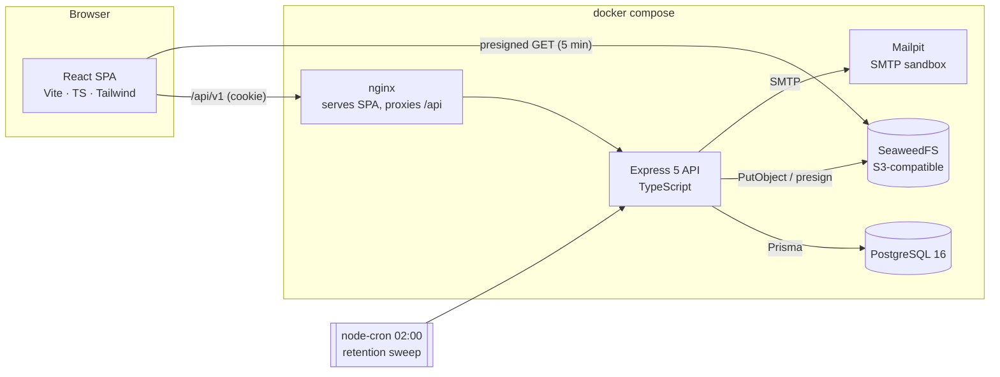

| Concern | Choice | Where |
|---|---|---|
| UI | React 19 + TypeScript + Tailwind v4 | `frontend/src` |
| API | Express 5 (async errors bubble up natively) | `backend/src/app.ts` |
| ORM / migrations | Prisma 6 | `backend/prisma` |
| Validation | Zod schemas next to each route | `backend/src/routes/*.ts` |
| Files | S3 SDK → SeaweedFS (swap the endpoint for AWS S3 or R2) | `backend/src/lib/storage.ts` |
| Email | Nodemailer + Handlebars → Mailpit | `backend/src/lib/mailer.ts` |
| Docs | OpenAPI 3 served by Swagger UI at `/api/docs` | `backend/openapi.json` |

In development, Vite serves the SPA on `:5173` and proxies `/api` to `:4000`. Browser and API are then same-origin, so the httpOnly cookie works without CORS tricks. In Docker, nginx does the same proxying.

---

## 2. Repository map

```
backend/
  prisma/
    schema.prisma          21 models, enums, indexes
    migrations/            SQL migrations (prisma migrate deploy)
    seed.ts                demo org, users, jobs, applications, interviews
  src/
    index.ts               boot: ensure S3 bucket, schedule retention cron, listen
    app.ts                 middleware stack + router mounting
    lib/
      env.ts               loads .env (Node built-in), validates JWT_SECRET
      auth.ts              JWT sign/verify, cookie, requireAuth, requireRole
      access.ts            WHO MAY SEE WHAT: canSeeJob, canSeeApplication, maskPII, job status rules
      pipeline.ts          stage engine: moveApplication, approvals, replaceStages, overlap check
      governance.ts        export, anonymize, retention
      mailer.ts            template render + non-blocking send + EmailLog
      storage.ts           S3 put/delete/presign
      audit.ts             append-only AuditLog writer
      http.ts              HttpError helpers, central error handler, pagination
    routes/
      auth.ts              register / login / logout / me
      jobs.ts              public board, job CRUD, status, questions, stages, criteria, kanban data
      candidate.ts         /me: profile, resumes, apply, applications, consents, export, deletion
      applications.ts      detail, move, reject, notes, email, resume URL, approvals
      interviews.ts        schedule, reschedule/cancel, my queue, scorecards
      reports.ts           overview, funnel, time-to-stage, sources, vacancies
      admin.ts             org settings, retention, data requests, audit log, templates, email log
      users.ts             staff management
  tests/                   Vitest + Supertest (see TESTING.md)
frontend/
  src/
    App.tsx                routes + role guards
    lib/                   api() wrapper, AuthProvider/RequireRole, useApi hook, formatters
    components/            design-system primitives (ui.tsx), layouts, toast, resume upload
    pages/                 public (JobBoard, JobDetail, Auth), portal/*, staff/*
    test/                  Vitest + Testing Library
docs/                      API, DATABASE (ER diagram), PHASES, WORKFLOW, TESTING
.github/workflows/ci.yml   typecheck + tests on every push
docker-compose.yml         db, storage, mailpit (+ api, web under the "app" profile)
```

**Rule of thumb:** routes are thin (parse → authorize → call `lib` → audit → respond). Every business rule that is reused or worth testing lives in `lib/`.

---

## 3. Request lifecycle (backend)

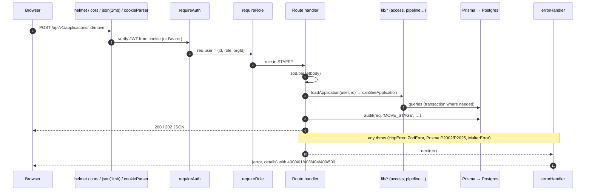

Error mapping (`lib/http.ts`):

| Thrown | Response |
|---|---|
| `HttpError(status, msg, details)` | that status, `{ error, details }` |
| `ZodError` | 400, `error` = first object-level message or "Validation failed", `details` = field errors |
| Prisma `P2002` (unique) | 409 "Already exists" |
| Prisma `P2025` (not found) | 404 |
| `MulterError` (file too big, etc.) | 400 |
| anything else | 500 (logged) |

---

## 4. Authentication and authorization

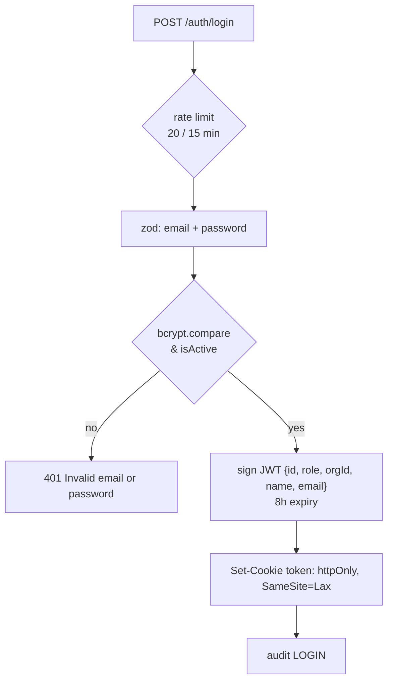

Every protected request then passes three layers:

1. **Authentication:** `requireAuth` reads the `token` cookie (or `Authorization: Bearer`). Missing or invalid → 401.
2. **Role gate:** `requireRole(...)` on the router or route. Wrong role → 403.
3. **Resource gate:** `lib/access.ts` decides on the specific record. This is what stops IDOR.

| Rule | Function |
|---|---|
| Staff see only their own org; hiring managers only the jobs they manage | `canSeeJob` |
| Candidates see only their own applications | `canSeeApplication` |
| Only Employer/Recruiter edit jobs | `canEditJob` |
| Interviewers get masked email and phone | `maskPII` |
| Approvals: Employer always, otherwise the configured role (an HM must own the job) | `canApprove` (in `pipeline.ts`) |

Reports apply the same scoping inside SQL (`reports.ts → scope()`), so a hiring manager's charts only include their jobs.

---

## 5. End-to-end hiring workflow

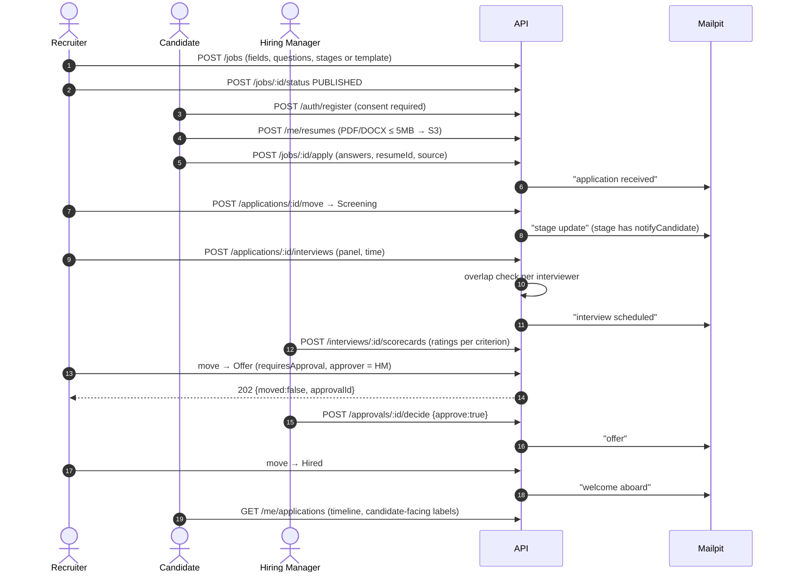

Every write in this flow also appends to `AuditLog`, and every stage change appends to `StageTransition`.

---

## 6. Job status machine

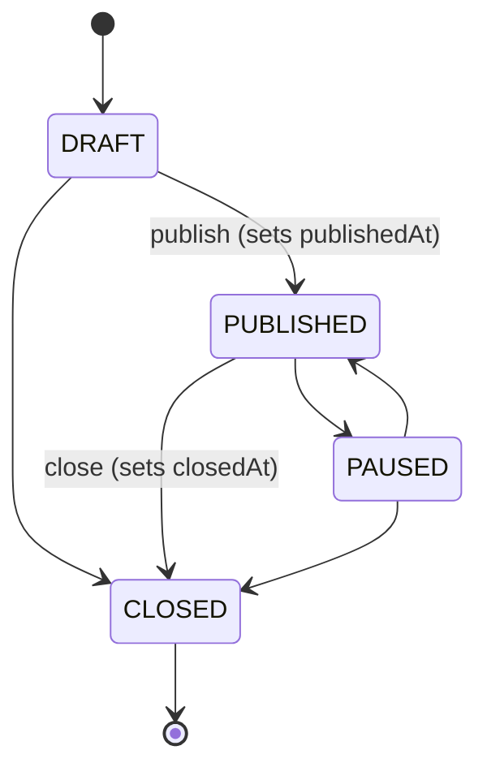

The table lives in `canTransitionJob` (`lib/access.ts`). An illegal move returns 409. Only `PUBLISHED` jobs appear on the public board or accept applications; applying to anything else returns 400. Application questions lock after the first application (409), because answers reference them.

---

## 7. Pipeline engine: moving a candidate

`moveApplication()` in `lib/pipeline.ts` is the **only** code path that changes a stage. The move, approval and reject endpoints all call it.

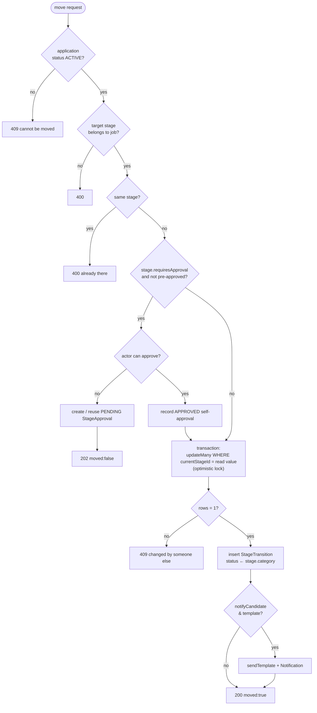

- Moving into a `HIRED` category stage sets the application to `HIRED`, and `REJECTED` sets it to `REJECTED`. Both are terminal: any later move returns 409.
- `rejectApplication()` finds the job's `REJECTED` stage and stores the reason.
- Deciding an approval: `POST /approvals/:id/decide`. Approve calls `moveApplication({approved:true})`. Deny marks the approval `REJECTED` and the candidate stays where they were.

---

## 8. Configurable workflow (USP G)

Every vacancy owns its own ordered `JobStage` rows, so no code change is needed to change a hiring process.

| Stage field | Effect |
|---|---|
| `name`, `order` | Kanban column and position |
| `category` ACTIVE / HIRED / REJECTED | drives the application status and analytics |
| `notifyCandidate`, `emailTemplateKey` | email on entering the stage |
| `requiresApproval`, `approverRole` | approval gate in the engine above |

`PUT /jobs/:id/stages` → `replaceStages()`:

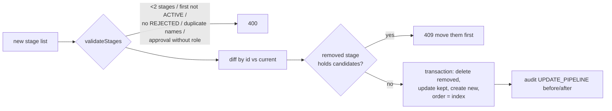

Stage lists can be saved as **pipeline templates** (`POST /pipeline-templates`) and reused when creating a job. The seed includes "Standard hiring" and a lean "Internship" template with an Employer-approved Offer stage.

---

## 9. Interviews and scorecards

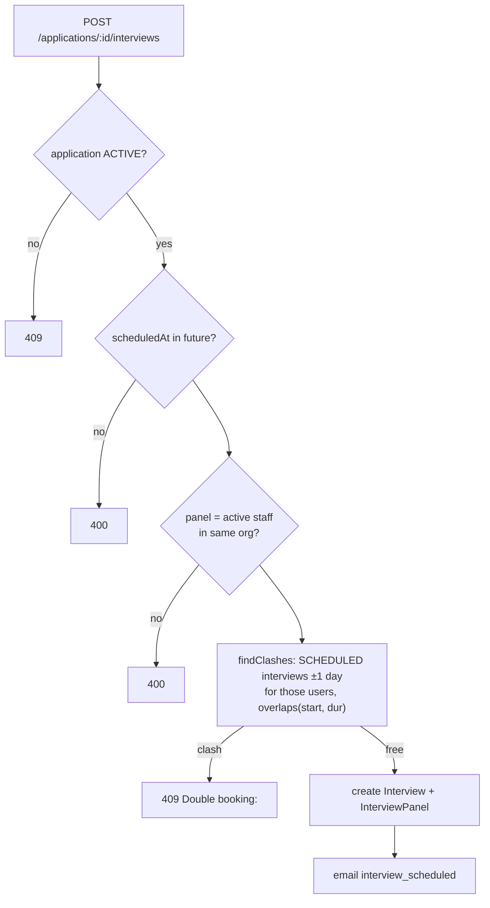

- **Reschedule / cancel / complete:** `PATCH /interviews/:id`. Only a `SCHEDULED` interview can change, and a new time re-runs the clash check and re-notifies the candidate.
- **Scorecard:** `POST /interviews/:id/scorecards`. The caller must be on the panel (403 otherwise) and the interview must be `SCHEDULED`. `ratings` must cover exactly the job's `ScorecardCriterion` names, each 1–5 (400 lists missing or extra criteria). The scorecard is upserted per interviewer.
- **Interviewer queue:** `GET /interviews/mine` returns candidate name, skills and experience, with masked email and phone.

---

## 10. Communication

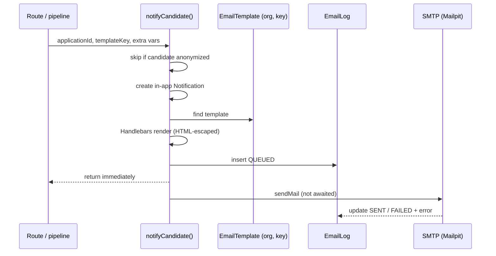

Template keys seeded per org: `application_received`, `stage_changed`, `interview_scheduled`, `offer`, `hired`, `rejected`. Templates are editable in the UI (`PUT /admin/email-templates/:key`), and recruiters can send any template manually from the candidate page. View delivered mail at http://localhost:8025.

---

## 11. Candidate data governance (USP H)

**Consent:** registration requires `DATA_PROCESSING` consent (stored with policy version, IP and time). Each application stores an `APPLICATION:<jobId>` consent. `TALENT_POOL` and `MARKETING` can be granted or withdrawn at any time (withdrawal sets `withdrawnAt`, so history is kept).

**Role-limited access:** see section 4. Resume links are 5-minute presigned URLs, and every staff resume view is audited (`VIEW_RESUME`).

**Export:** `GET /me/export` returns a JSON file with profile, consents, applications (answers, timeline, interviews), notifications, data requests and emails received.

**Deletion workflow:**

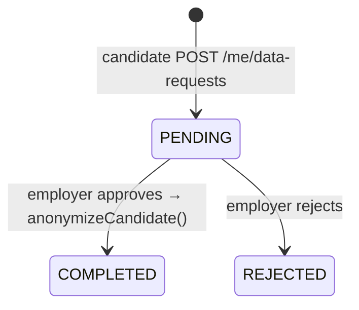

`anonymizeCandidate()`:

1. Deletes resume files from S3, then the resume rows.
2. Replaces the name with "Deleted Candidate" and the email with `deleted-<id>@anonymized.local`, sets a random password hash and `isActive = false`.
3. Nulls phone, location, LinkedIn, headline and skills, and sets `anonymizedAt`.
4. Deletes application answers, internal notes and notifications. Rewrites the email log recipient.
5. **Keeps** application rows and stage transitions, so funnel and time-to-stage stay correct.

**Retention:** `Organization.retentionDays` (30–3650). The nightly cron at 02:00 and the "Run retention now" button call `runRetention()`. It anonymizes candidates whose every application in the org is `REJECTED` or `WITHDRAWN` and was last updated before the cutoff, and logs `RETENTION_RUN`.

**Audit:** `AuditLog` stores actor, role, action, entity, before/after JSON, IP and time. Employers and recruiters can view it, paginated and filterable.

---

## 12. Reporting

All reports are single SQL aggregates (no rows loaded into Node), scoped by org, hiring manager, `jobId`, `from` and `to`.

| Endpoint | Source | Computation |
|---|---|---|
| `/reports/overview` | Application, Interview | `COUNT(*) FILTER (WHERE …)` per status, last 7 days, upcoming interviews |
| `/reports/funnel` | StageTransition | distinct applications that ever reached each non-rejected stage ÷ total |
| `/reports/time-to-stage` | StageTransition | `AVG(transition.createdAt − appliedAt)` in days per stage |
| `/reports/sources` | Application.source | count and hired per source |
| `/reports/vacancies` | Job.status | count per status |

`StageTransition` is append-only (written in the same transaction as the move), which is why history-based metrics stay accurate after candidates move on.

---

## 13. Frontend workflow

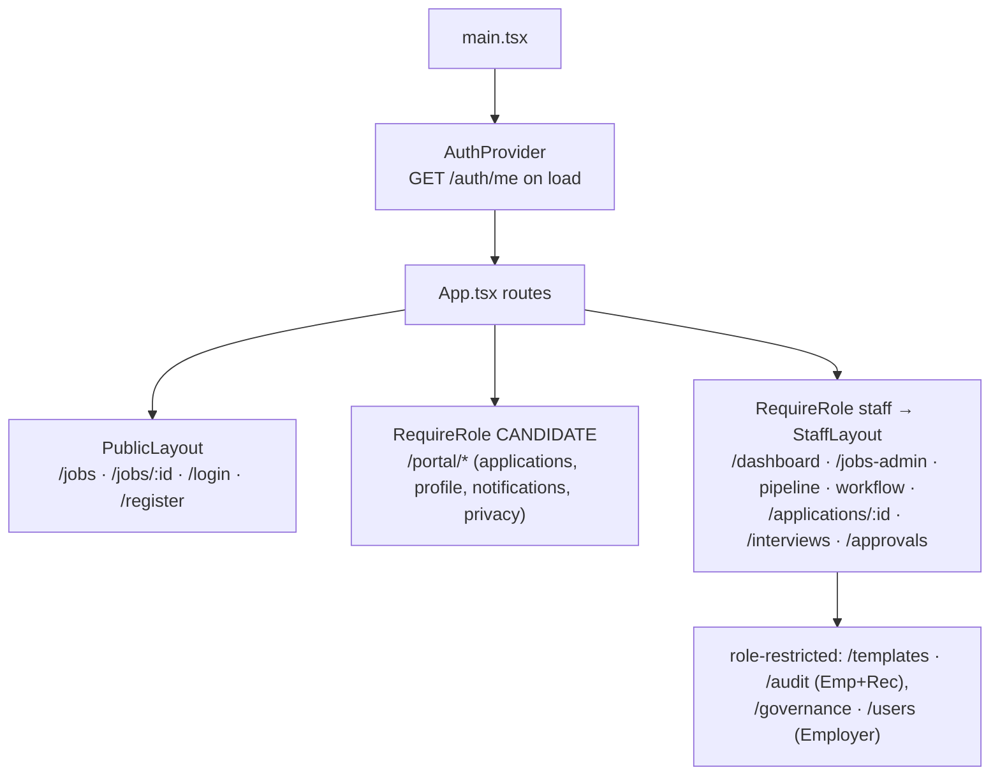

- **Data:** `useApi(path)` fetches on mount and exposes `{data, error, loading, reload}`. Mutations call `api()` directly, which sends JSON with `credentials: 'include'` and throws `ApiError {status, error, details}`. `ErrorBox` shows the message plus every field error.
- **Guards:** `RequireRole` sends anonymous users to `/login` and wrong roles to their own home. The API enforces the same rules again, so the UI guard is only a convenience.
- **Kanban:** native HTML5 drag-and-drop, plus a "Move to…" select for touch screens. A 202 response shows "Sent for approval" and an "Approval pending" badge.
- **Design system:** `index.css` remaps Tailwind's palette to a warm gray canvas with a coral accent and defines the `surface` card utility. `ui.tsx` holds the primitives plus `MatchRing` and `skillMatch()` (the share of a job's skills found on the candidate profile).

---

## 14. Developer workflow

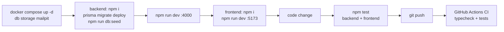

| Task | Command (from `backend/` unless noted) |
|---|---|
| New schema change | edit `schema.prisma` → `npx prisma migrate dev --name <change>` |
| Reset demo data | `npm run db:seed` (wipes and reseeds the dev DB; log in again afterwards) |
| Browse the database | `npx prisma studio` |
| API docs | http://localhost:4000/api/docs |
| Full stack in Docker | repo root: `docker compose --profile app up -d --build` then `docker compose exec api npm run db:seed` |

Seeded logins (password `Password123!`): `employer@acme.test`, `recruiter@acme.test`, `manager@acme.test`, `candidate@acme.test`.
